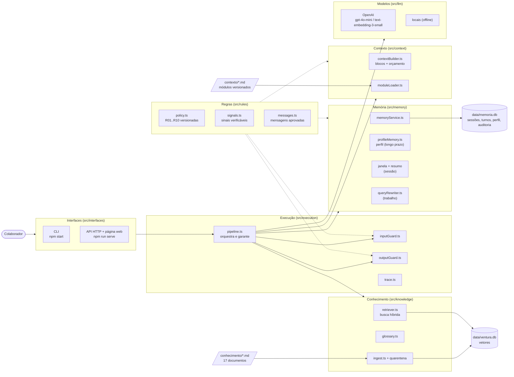
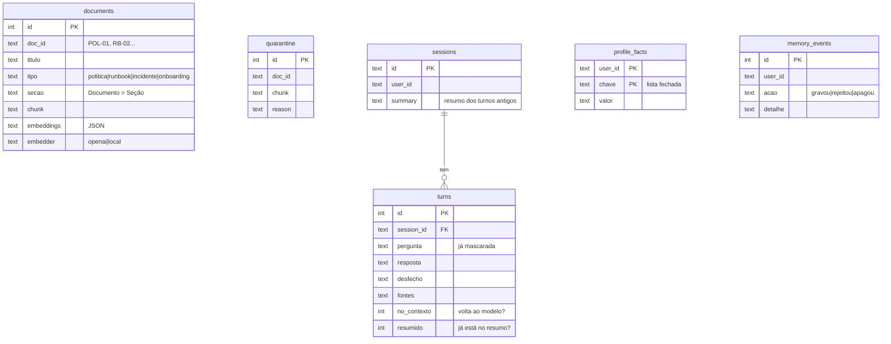

# 2. Arquitetura do sistema

[← Voltar ao README](../README.md)

## Visão geral

O Ventura Assist é organizado em **camadas com responsabilidade única**. A regra de dependência é verificada por teste
([`tests/architecture.test.ts`](../tests/architecture.test.ts)): se, por exemplo, a camada de regras importar a de
execução, o build quebra.



| Camada | Pasta | Responsabilidade | Pode importar |
|---|---|---|---|
| Compartilhado | `src/shared` | tipos, configurações, normalização de texto | nada |
| Regras | `src/rules` | **o quê**: regras versionadas, sinais verificáveis, mensagens aprovadas | shared |
| Modelos | `src/llm` | clientes OpenAI e locais, retentativa, tradução de erros | shared |
| Conhecimento | `src/knowledge` | leitura dos documentos, chunks, embeddings, busca híbrida, glossário, quarentena | shared, rules, llm |
| Memória | `src/memory` | perfil de longo prazo, sessão (janela + resumo), busca contextualizada, auditoria | shared, rules |
| Contexto | `src/context` | módulos estáticos versionados + montagem da janela de contexto com orçamento | shared, rules |
| Execução | `src/execution` | **quando e com que garantia**: ordem das etapas, guardas determinísticas, trace | todas acima |
| Interfaces | `src/interfaces` | CLI, API HTTP, página web, composição das dependências | todas acima |
| Avaliação | `src/evaluation` | casos de comportamento, avaliador, juiz LLM, relatório | todas acima |

Princípio central, herdado do D03: **o prompt orienta, a execução garante.** As instruções reduzem a chance de o modelo
errar; as guardas em código garantem que, se ele errar, a falha não chega ao colaborador.

## Tecnologias e justificativas

| Escolha | Alternativas consideradas | Por que esta |
|---|---|---|
| **Node.js 22.18+ com TypeScript nativo** | Python | Mesma stack do projeto base da aula; o Node executa `.ts` sem build e traz `node:sqlite` e `node:test`, então o projeto tem **uma única dependência de produção** (`openai`). |
| **SDK `openai`** | LangChain, LlamaIndex | É o SDK da aula. Um framework de orquestração esconderia justamente o que o trabalho precisa mostrar (montagem do contexto, memória, guardas). A interface `LlmClient` permite trocar o provedor sem mexer no pipeline. |
| **Modelo `gpt-4o-mini`** | gpt-4o, modelos abertos | Bom português, *JSON mode* (contrato de saída), custo baixo para 3 execuções x 39 casos x 3 configurações e latência adequada a chat. As guardas determinísticas compensam erros pontuais de um modelo menor. Configurável em `OPENAI_MODEL`. |
| **Embeddings `text-embedding-3-small` (1536 dim.)** | `-large`, modelos locais | Multilíngue, barato e o mesmo da aula. Para 71 trechos curtos e um domínio fechado, a dimensão maior não compensa. |
| **Base vetorial em SQLite (`node:sqlite`)** | Pinecone, pgvector, Chroma | Com 71 chunks, a busca por força bruta (cosseno em todos os vetores) leva poucos milissegundos e não exige infraestrutura. O banco guarda **qual embedder gerou cada vetor**, porque vetores de modelos diferentes não são comparáveis. Para dezenas de milhares de chunks, o `VectorRepository` seria trocado por pgvector ou Pinecone (índice ANN) sem mudar o resto. |
| **Busca híbrida** (0,7 semântica + 0,3 palavra-chave) | só semântica | Prazos, siglas e nomes de sistema ("AG-CONT", "FR-AV-01", "ASO") são palavras exatas; a parte lexical recupera esses termos. É a evolução do `hybridScore` da aula. |
| **Glossário do domínio** | só embeddings | Liga o vocabulário do colaborador ("de casa", "crachá") ao dos documentos ("trabalho híbrido", "credencial"). Arquivo editável por quem não programa. |
| **Memória em SQLite separado** (`data/memoria.db`) | Redis, mesma base | Memória é dado do **usuário**, conhecimento é dado da **empresa**: arquivos separados facilitam apagar, auditar e aplicar retenção (LGPD). |
| **Extração de perfil determinística** | extração por LLM | Controle e auditoria: só chaves permitidas, nenhuma regra ou instrução vira memória. Ver [memória](04-memoria.md). |
| **Modelos locais** (embedder por hashing + modelo extrativo) | só OpenAI | Testes, demo e avaliação rodam **sem chave e de forma determinística**. Também serviram para medir o pipeline isolado da variação do modelo. |
| **`node:http` + HTML estático** | Express, React | A interface é demonstrativa; zero dependências e uma página que mostra o trace, o manifesto do contexto e a memória. |

## Fluxo de uma requisição (do input à resposta)

O mesmo fluxo com os dados reais de uma pergunta (scores, tokens, saída do modelo) está em
[9. Fluxo de dados e ingestão](09-fluxo-de-dados-e-ingestao.md).

```mermaid
sequenceDiagram
  autonumber
  actor C as Colaborador
  participant I as Interface (CLI/HTTP)
  participant P as Pipeline
  participant G as Guarda de entrada
  participant M as Memória
  participant K as Conhecimento
  participant X as Contexto
  participant L as LLM
  participant O as Guarda de saída

  C->>I: mensagem
  I->>P: answer(usuario, sessao, mensagem)
  P->>M: é pedido sobre a memória? (ver / apagar)
  M-->>P: não
  P->>G: validar, detectar emergência, senha, extração, injeção, dados de terceiros
  alt bloqueio
    G-->>P: mensagem aprovada (o modelo não é chamado)
  else segue
    G-->>P: texto com dados pessoais mascarados + alertas (ex.: R07 pedido de ação)
    P->>M: aprender perfil (chaves permitidas; rejeita regra/instrução/senha)
    P->>M: ler perfil relevante, resumo, janela; contextualizar a busca
    P->>K: busca híbrida (consulta + glossário), score mínimo, topK, 2ª barreira contra injeção
    alt nenhum trecho relevante
      K-->>P: vazio -> "não encontrei" (o modelo não é chamado)
    else trechos
      P->>X: montar blocos com orçamento de tokens
      X-->>P: mensagens + manifesto
      P->>L: completar (JSON) com retentativa e backoff
      L-->>P: {decisao, fontes, memoria_usada, resposta}
      P->>O: contrato, canário, autorização, fontes, números sem respaldo, PII, forma
      O-->>P: aprovada / corrigida / trocada por mensagem aprovada
    end
  end
  P->>M: gravar turno (só turnos atendidos voltam ao contexto) e resumir se passou do limite
  P-->>I: resposta + fontes + memória usada + trace + manifesto
  I-->>C: resposta com "Fontes: ..."
```

Etapas, decisões e o que acontece quando cada uma bloqueia:

| # | Etapa | Implementação | Se bloquear / falhar |
|---|---|---|---|
| 0 | Pedido sobre a memória | [`intents.ts`](../src/memory/intents.ts) | Lista ou apaga o perfil, sem modelo |
| 1 | Guarda de entrada | [`inputGuard.ts`](../src/execution/inputGuard.ts) | Mensagem aprovada; o modelo não é chamado e nada é memorizado |
| 2 | Aprender perfil | [`profileMemory.ts`](../src/memory/profileMemory.ts) | Rejeições ficam na auditoria |
| 3 | Só informou perfil | [`pipeline.ts`](../src/execution/pipeline.ts) | Confirma o que anotou, sem modelo |
| 4 | Ler memória | [`memoryService.ts`](../src/memory/memoryService.ts) | - |
| 5 | Busca | [`retriever.ts`](../src/knowledge/retriever.ts) | Sem trecho acima do corte: "não encontrei" (R02), sem modelo |
| 6 | Contexto | [`contextBuilder.ts`](../src/context/contextBuilder.ts) | Corta o que passa do orçamento e registra no manifesto |
| 7 | Geração | [`openaiClient.ts`](../src/llm/openaiClient.ts) + [`withRetry.ts`](../src/llm/withRetry.ts) | Erro: mensagem segura (fail-closed) |
| 8 | Guarda de saída | [`outputGuard.ts`](../src/execution/outputGuard.ts) | Violação crítica/alta: mensagem aprovada; forma: corrige |
| 9 | Gravar turno | [`memoryRepository.ts`](../src/memory/memoryRepository.ts) | Turnos bloqueados ficam no log, mas não voltam ao contexto |

## Modelo de dados



## Interfaces

| Interface | Comando | Uso |
|---|---|---|
| CLI | `npm start [-- --offline] [-- --trace] [-- --usuario ana]` | Chat no terminal; `/memoria`, `/esquecer`, `/nova`, `/contexto` |
| API HTTP | `npm run serve [-- --offline] [-- --porta 3000]` | `POST /api/chat`, `GET/DELETE /api/memoria/:usuario`, `GET /api/saude` |
| Página web | `http://localhost:3000` | Chat com botões de exemplo e painéis de **trace**, **manifesto do contexto** e **memória** |
| Debug da busca | `npm run debug -- "pergunta"` | Ranking dos chunks com score, corte e expansão do glossário (aula: `ragDebug`) |
| Contexto real | `npm run contexto -- "pergunta"` | Imprime as mensagens exatas enviadas ao modelo |
| Fluxo de dados | `npm run fluxo -- "pergunta"` | O dado em cada etapa, do arquivo .md à resposta ([doc 9](09-fluxo-de-dados-e-ingestao.md)) |
| Cenários | `npm run cenarios` | Conversas completas em vários turnos e sessões ([doc 10](10-demonstracao-e-cenarios.md)) |

Exemplo de chamada:

```bash
curl -s -X POST localhost:3000/api/chat -H "content-type: application/json" -d "{\"usuario\":\"ana\",\"mensagem\":\"Qual a tolerância de atraso no gate?\"}"
```

A resposta traz `resposta`, `decisao`, `desfecho`, `fontes`, `memoria` (usada, gravada, rejeitada, consulta), `trace`
e `contexto.manifest`. A sessão de um usuário não pode ser usada por outro (HTTP 400).
