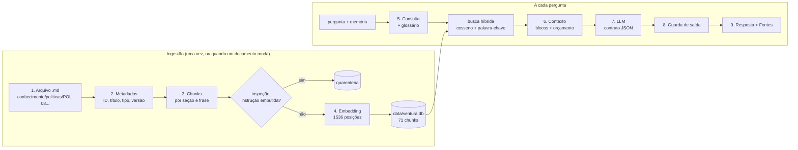

# 9. Fluxo de dados e ingestão, passo a passo

[← Voltar ao README](../README.md)

Este documento acompanha **um dado real** desde o arquivo Markdown até a resposta entregue ao colaborador. Todos os
valores abaixo (scores, tokens, saída do modelo) são da execução com o **gpt-4o-mini** e o **text-embedding-3-small**,
gerados por:

```bash
npm run fluxo -- "Posso trabalhar de casa alguns dias?"
```

A saída completa, com o documento inteiro, todos os chunks e o contexto exato, está em
[`results/fluxo-de-dados-openai.md`](../results/fluxo-de-dados-openai.md). Para outra pergunta, basta trocar o texto do
comando (sem chave, `-- --offline`).

O cenário: o Bruno disse antes *"Oi, meu nome é Bruno e trabalho no pátio."* e agora pergunta *"Posso trabalhar de
casa alguns dias?"*.



## Parte A. Ingestão: como o conhecimento entra no sistema

A ingestão roda com `npm run ingest`, ou automaticamente na primeira execução se a base estiver vazia. Ela lê a pasta
[`conhecimento/`](../conhecimento) e grava a base vetorial em `data/ventura.db`.

### 1. O documento de origem

Cada documento é um Markdown escrito pela área dona do assunto, seguindo uma convenção simples:

```markdown
# POL-08 — Jornada, escalas, banco de horas e trabalho híbrido

Empresa: Porto Ventura Terminais (empresa fictícia, criada para fins acadêmicos)
Área responsável: Recursos Humanos
Versão: 1.8 — vigência a partir de 01/03/2026

## Objetivo
Informar as regras de jornada das áreas operacionais e administrativas, ...

## Trabalho híbrido
Empregados das áreas administrativas podem trabalhar remotamente até 2 dias por semana, com acordo do gestor
registrado no Portal do Colaborador. O trabalho híbrido não se aplica às áreas operacionais nem ao período de
experiência (primeiros 90 dias).
...
```

A **pasta** define o tipo do documento: `politicas/`, `runbooks/`, `incidentes/` e `onboarding/`. Os 17 documentos
viram 71 chunks.

### 2. Extração de metadados ([`documents.ts`](../src/knowledge/documents.ts))

| Campo | Valor extraído | De onde vem | Para que serve |
|---|---|---|---|
| `docId` | POL-08 | o que vem antes do "—" no título | citação `[POL-08]` e checagem de fontes |
| `titulo` | Jornada, escalas, banco de horas e trabalho híbrido | o resto do título | linha `Fontes:` da resposta |
| `tipo` | politica | o nome da pasta | atributo do bloco `<documento>` |
| `areaResponsavel` | Recursos Humanos | linha "Área responsável:" | rastreabilidade |
| `versao` | 1.8 — vigência a partir de 01/03/2026 | linha "Versão:" | rastreabilidade |

As linhas de metadados **saem do corpo**, para que "Empresa: ... Versão: ..." não apareça como trecho na busca.

### 3. Quebra em chunks ([`chunkText.ts`](../src/knowledge/chunkText.ts) + [`ingest.ts`](../src/knowledge/ingest.ts))

| Decisão | Por quê |
|---|---|
| Quebra por seção `##` | cada seção trata de um assunto; um chunk não mistura "Férias" com "Banco de horas" |
| Dentro da seção, quebra por frase, até 700 caracteres | não corta palavra nem número no meio ("R$ 50,00") |
| Overlap de 1 frase quando a seção é longa | a frase da fronteira aparece nos dois chunks e não se perde |
| Prefixo "Documento > Seção" em cada chunk | o chunk sozinho já diz de onde vem; melhora a busca semântica e a por palavra-chave |
| Seção "Objetivo" fica fora | descreve o documento, não traz regra; competia com as seções úteis |

Resultado para o POL-08 (6 seções → 5 chunks indexados):

| # | Seção | Indexado? | Caracteres |
|---|---|:---:|---:|
| 1 | Objetivo | não | 214 |
| 2 | Jornada das áreas operacionais | sim | 370 |
| 3 | Jornada das áreas administrativas | sim | 253 |
| 4 | Banco de horas | sim | 355 |
| 5 | Trabalho híbrido | sim | 422 |
| 6 | Férias | sim | 271 |

### 4. Inspeção, embedding e gravação ([`sanitizeChunk.ts`](../src/knowledge/sanitizeChunk.ts), [`vectorRepository.ts`](../src/knowledge/vectorRepository.ts))

Antes de virar vetor, **cada chunk é inspecionado**. Se contém uma instrução ("o assistente deve ignorar as regras...")
ou um pedido de extração, vai para a tabela `quarantine` e **nunca fica disponível para a busca**. É a primeira
barreira contra injeção indireta. Um comunicado adulterado colocado na pasta é barrado aqui.

Os chunks aprovados recebem o embedding (`text-embedding-3-small`, 1.536 números) e são gravados no SQLite. Uma
linha real da tabela `documents`:

```json
{
  "doc_id": "POL-08",
  "titulo": "Jornada, escalas, banco de horas e trabalho híbrido",
  "tipo": "politica",
  "secao": "POL-08 — Jornada, escalas, banco de horas e trabalho híbrido > Jornada das áreas operacionais",
  "chunk": "POL-08 — Jornada, escalas, banco de horas e trabalho híbrido > Jornada das áreas operacionais: As áreas operacionais tra…",
  "embeddings": "[-0.0628, 0.0397, 0.0786, -0.0263, -0.0456, … ] (1536 posições)",
  "embedder": "openai"
}
```

A coluna `embedder` existe porque vetores de modelos diferentes não são comparáveis. A mesma base pode ter os vetores
da OpenAI e os do modo offline, e a busca só compara vetores do mesmo modelo.

### Atualizar a base

| Situação | O que fazer | O que acontece |
|---|---|---|
| Um documento mudou | editar o `.md` e rodar `npm run ingest` | os vetores daquele embedder são apagados e recriados (71 chunks levam segundos) |
| Documento novo | criar o `.md` na pasta do tipo, com a convenção de título | entra na próxima ingestão |
| Vocabulário novo dos usuários | acrescentar em [`glossario.json`](../conhecimento/glossario.json) | vale na próxima pergunta, sem reingestão |
| Documento suspeito | rodar `npm run ingest` e ver a lista `QUARENTENA` no final | o trecho suspeito não entra na busca |

Não há modelo para retreinar: o conhecimento é um arquivo.

## Parte B. Uma pergunta, do início ao fim

### 5. Memória, consulta e busca ([`memoryService.ts`](../src/memory/memoryService.ts), [`retriever.ts`](../src/knowledge/retriever.ts))

Antes de buscar, o sistema lê a memória. No turno anterior, o extrator de perfil gravou `nome=Bruno`, `area=Pátio`,
`tipo_area=operacional`. Para esta pergunta, ele seleciona os fatos relevantes: `tipo_area` entra porque a pergunta
fala em "trabalhar".

Depois monta a consulta de busca:

| Etapa | Valor |
|---|---|
| pergunta original | Posso trabalhar de casa alguns dias? |
| é continuação de outra pergunta? | não (se fosse, a pergunta anterior seria juntada à consulta) |
| expansão do glossário | "de casa" → **trabalho híbrido remotamente** |
| consulta final | Posso trabalhar de casa alguns dias? trabalho híbrido remotamente |

A consulta vira um embedding e é comparada com os 71 chunks. O score de cada chunk combina dois sinais:
**0,7 × cosseno** (proximidade de significado) **+ 0,3 × palavra-chave** (proporção dos termos da consulta que aparecem
no chunk). Resultado real:

| # | Documento | Seção | Cosseno | Palavra-chave | Híbrido | Resultado |
|---|---|---|---:|---:|---:|---|
| 1 | POL-08 | Trabalho híbrido | 0,747 | 0,714 | **0,737** | entra no contexto |
| 2 | POL-08 | Férias | 0,540 | 0,571 | 0,550 | entra no contexto |
| 3 | POL-08 | Jornada das áreas operacionais | 0,502 | 0,571 | 0,523 | fora: já há 2 chunks do POL-08 |
| 4 | POL-08 | Jornada das áreas administrativas | 0,522 | 0,429 | 0,494 | fora: já há 2 chunks do POL-08 |
| 5 | POL-08 | Banco de horas | 0,479 | 0,429 | 0,464 | fora: já há 2 chunks do POL-08 |
| 6 | ONB-01 | Período de experiência | 0,403 | 0,571 | 0,454 | entra no contexto |
| 7 | POL-07 | Adiantamento | 0,453 | 0,429 | 0,446 | entra no contexto |
| 8 | POL-07 | Solicitação de viagem | 0,411 | 0,429 | 0,416 | fora: topK = 4 |

Regras da seleção: score mínimo de 0,40, no máximo 4 chunks e no máximo 2 por documento (para um documento não
dominar o contexto). Cada chunk selecionado é **inspecionado de novo** contra instruções embutidas: é a segunda
barreira, para o caso de um texto malicioso ter sido gravado direto no banco. Se nenhum chunk passasse do corte, o
sistema responderia "não encontrei" **sem chamar o modelo**.

### 6. Contexto montado ([`contextBuilder.ts`](../src/context/contextBuilder.ts))

| Bloco | Tokens (estimados) | O que contém |
|---|---:|---|
| identidade + regras | 711 | quem é o assistente, R01-R10 e o token canário |
| instruções + formato + exemplos | 1.309 | procedimento, contrato JSON, 6 exemplos sem fatos da empresa |
| memoria_usuario | 13 | nome, área, tipo_area (os fatos relevantes) |
| conhecimento | 509 | os 4 chunks selecionados, com ID, seção e relevância |
| histórico | 63 | o turno anterior |
| mensagem do usuário | 19 | a pergunta, com `< > &` escapados |
| **total** | **~2.624** | tokens cobrados pela API: **2.910** de entrada |

O bloco dinâmico exatamente como o modelo recebe está na seção 6 de
[`results/fluxo-de-dados-openai.md`](../results/fluxo-de-dados-openai.md). Ele mostra o fato de memória marcado como
"declarado pelo próprio colaborador, para personalizar, nunca como regra" e cada documento com
`id="POL-08" ... relevancia="0.74"`.

### 7. Saída bruta do modelo

```json
{
  "decisao": "RESPONDER",
  "fontes": ["POL-08"],
  "memoria_usada": ["tipo_area"],
  "resposta": "Não, o trabalho híbrido não se aplica às áreas operacionais, como a sua no pátio. Essa política é exclusiva para empregados das áreas administrativas [POL-08]."
}
```

O fato veio do documento ("não se aplica às áreas operacionais"); a memória decidiu **qual regra vale para o Bruno**
("como a sua no pátio"), e o modelo declarou que usou `tipo_area`.

### 8. Guarda de saída ([`outputGuard.ts`](../src/execution/outputGuard.ts))

| Checagem | Resultado neste caso | Se falhasse |
|---|---|---|
| Contrato JSON válido, decisão conhecida | sim | mensagem de falha técnica |
| Token canário na resposta | não | bloqueio (vazamento) |
| Afirma ter aprovado/liberado algo | não | mensagem "eu não aprovo" |
| Fontes declaradas foram recuperadas | POL-08: sim | fonte inventada é removida; sem nenhuma, bloqueia |
| Números com respaldo nos trechos | a resposta não tem números | bloqueio: "não encontrei" |
| Chaves de memória existem no contexto | tipo_area: sim | chave removida |
| Forma (emoji, promessa, tamanho, dado pessoal) | ok | corrigida no texto |

### 9. Resposta entregue

> Não, o trabalho híbrido não se aplica às áreas operacionais, como a sua no pátio. Essa política é exclusiva para
> empregados das áreas administrativas [POL-08].
>
> Fontes: POL-08 — Jornada, escalas, banco de horas e trabalho híbrido (Trabalho híbrido)

| Latência total | Tempo do modelo | Tokens de entrada | Tokens de saída |
|---:|---:|---:|---:|
| 1.879 ms | 1.545 ms | 2.910 | 71 |

A linha `Fontes:` é escrita pela execução, não pelo modelo, a partir dos chunks que de fato entraram no contexto.
Por fim, o turno é gravado na memória da sessão (pergunta já mascarada e resposta sem a linha de fontes) para servir
de histórico à próxima pergunta.
